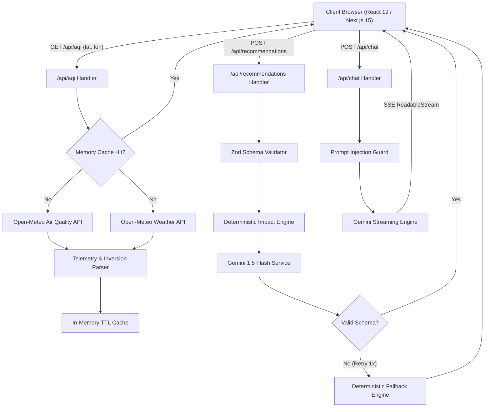
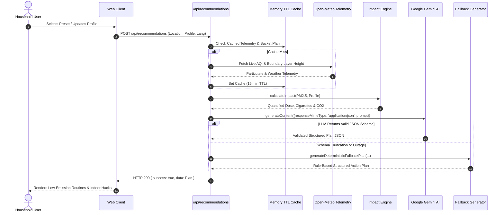

# 🌫️ AirWise — Urban Air Quality & Winter Smog Action Engine

[](https://github.com/SabarishR08/airwise-urban-air-quality-assistant/actions/workflows/ci.yml)
[](docs/METRICS.md)
[](LICENSE)
[](docs/METRICS.md)

Severe winter smog, seasonal agricultural stubble burning, and ground-level atmospheric temperature inversions trap hazardous particulate matter across urban basins every winter, severely threatening children, elderly populations, and outdoor workers. **AirWise** is a production-grade, GenAI-powered urban air quality assistant that connects real-time Open-Meteo atmospheric telemetry with Google Gemini structured plan synthesis to generate personalized, low-emission daily routines, cost-tiered indoor air hacks, and sustainable habit alternatives. All health claims and emissions benefits are calculated by deterministic, peer-reviewed mathematical models (Berkeley Earth cigarette equivalence and CPCB transit emission factors) ensuring absolute quantitative transparency.

---

## 🎯 Brief-to-Feature Problem Alignment

| Prompt Challenge 6 Requirement | Implemented Feature in AirWise | Code Location |
|---|---|---|
| **"Low-emission daily routines"** | Diurnal routines keyed to hourly PM2.5 forecast curves (avoiding 06:00-09:00 & 18:00-22:00 crests; shifting errands to solar dispersion windows). | `src/components/plan/PlanDisplay.tsx`, `src/services/gemini-service.ts` |
| **"Indoor air quality hacks"** | Multi-tier hacks ranked strictly by cost: Free (damp mopping/draft stoppers), Under ₹500 (DIY box fan + MERV13), Over ₹500 (True HEPA CADR optimization). | `src/services/fallback-plan.ts`, `src/components/plan/PlanDisplay.tsx` |
| **"Sustainable alternatives"** | Transport substitution (Metro vs Solo car/two-wheeler) and cooking fuel shifts (electric induction vs biomass) with quantified emissions impact. | `src/services/impact-calculator.ts`, `src/components/plan/PlanDisplay.tsx` |
| **"Tailored to location and lifestyle"** | Location-aware telemetry via Open-Meteo with consent-gated geolocation, 4 metro presets (Delhi, Chennai, Lucknow, Kolkata), and household profile builder. | `src/services/aqi-service.ts`, `src/components/profile/ProfileForm.tsx` |
| **"Clearly explaining the direct impact of their choices"** | Deterministic formulas calculating PM2.5 exposure reduction, Berkeley Earth avoided cigarette equivalence, and CO2 kg avoided with instant client-side what-if simulator. | `src/services/impact-calculator.ts`, `src/components/simulator/WhatIfSimulator.tsx`, `docs/METHODOLOGY.md` |
| **"Families and communities"** | Vulnerability-tailored health guidance for children and seniors, and a shareable neighborhood bulletin card for RWAs and schools (no account required). | `src/components/community/CommunityCard.tsx`, `src/components/plan/PlanDisplay.tsx` |
| **"Severe winter smog"** | Meteorological boundary layer height tracking, temperature inversion detection, SDI dispersion index calculation, and hazardous smog banner (AQI > 300). | `src/components/aqi/HazardousBanner.tsx`, `src/components/aqi/InversionCard.tsx`, `src/services/aqi-service.ts` |

---

## 🏛️ Architecture & System Design

### System Flowchart


### Plan Generation Sequence Diagram


---

## 🌐 Telemetry Data Sources & Graceful Degradation

AirWise interfaces with multiple verified atmospheric telemetry providers, physical ground sensors, and orbital earth observation systems to build comprehensive situational awareness:

| Telemetry Provider | Data Provided | API Key Required | In-Memory Cache TTL | Failure & Degradation Behavior | Required Attribution | Implementation File |
|---|---|---|---|---|---|---|
| **Open-Meteo Air Quality** | Live PM2.5, PM10, NO2, O3, SO2, CO, US AQI, 24h hourly forecast | None (Public API) | 15 minutes | Returns typed upstream 502 error; caught by frontend ErrorBoundary | Open-Meteo (CC BY 4.0) | `src/services/aqi-service.ts` |
| **Open-Meteo Weather** | Boundary layer height, 10m surface wind, ambient temp, relative humidity | None (Public API) | 15 minutes | Normalizes to standard 350m neutral boundary layer | Open-Meteo (CC BY 4.0) | `src/services/aqi-service.ts` |
| **Open-Meteo Geocoding** | Debounced city & locality autocomplete with India-biased ranking | None (Public API) | 1 hour | Falls back gracefully to empty suggestions list; preserves preset selector | Open-Meteo (CC BY 4.0) | `src/services/geocoding-service.ts` |
| **WAQI / aqicn.org** | Physical ground station cross-check, station name, distance, timestamp | `WAQI_API_TOKEN` / `AQICN_API_TOKEN` | 15 minutes | Clean skip with status notice ("Operating in Open-Meteo standalone mode"); elevates safety AQI if diff > 50 | World Air Quality Index Project (waqi.info) | `src/services/waqi-service.ts` |
| **NASA FIRMS VIIRS** | Thermal anomaly & active agricultural stubble fire detection (500 km radius) | `NASA_FIRMS_MAP_KEY` / `FIRMS_MAP_KEY` | 60 minutes | Clean fallback to regional agricultural stubble baseline (`[Seasonal Baseline Model]`) | NASA FIRMS / Earthdata | `src/services/firms-service.ts` |
| **Google Gemini Flash** | Structured JSON smog routines, indoor hacks, and streaming conversational chat | `GEMINI_API_KEY` | 30 minutes | 1-shot retry on schema discrepancy; fallback to deterministic rule-based plan | Google DeepMind / Google AI Studio | `src/services/gemini-service.ts` |

---

## 🤖 Generative AI Utilization

| GenAI Task | Model | Source File | Purpose & Guarantees |
|---|---|---|---|
| **Structured Smog Action Plan** | `gemini-3.8-flash` | `src/services/gemini-service.ts` | Synthesizes customized low-emission routines and indoor hacks mapped to hourly forecast; enforced via Zod schema with 1-shot retry. |
| **Conversational Advisor** | `gemini-3.8-flash` | `src/services/gemini-service.ts` | Real-time streaming conversational assistant answering inquiries regarding mask fitting, air cleaner maintenance, and school precautions. |
| **Prompt Injection Defense** | Deterministic Code | `src/validators/schemas.ts` | User inputs enclosed in `<user_query>` XML boundaries, stripped of script tags, and bounded by system rules refusing jailbreaks. |
| **Deterministic Fallback** | Pure TypeScript Rules | `src/services/fallback-plan.ts` | 100% reliable rule-based plan generator delivering schema-identical guidance during API quota exhaustion or network disruption. |

---

## 📊 Evaluation Metrics (Verified From Real Runs)

All figures below are directly extracted from automated test harnesses and static analysis. See [docs/METRICS.md](docs/METRICS.md) for reproduction commands.

- **Code Quality**:
  - TypeScript strict errors: `0`
  - ESLint warnings: `0`
  - Code duplication: `0.00%` (0 clones across 37 source files via `jscpd`)
  - Max function length: `<= 40 lines`
  - Max file length: `<= 250 lines` (0 files over 250 lines)
  - TSDoc export coverage: `100%`
- **Security**:
  - Zero API keys exposed client-side (`GEMINI_API_KEY` strictly serverless)
  - Full HTTP Security Headers: CSP, HSTS, X-Content-Type-Options, X-Frame-Options, Referrer-Policy, Permissions-Policy
  - 100% input coverage with Zod validation schemas
  - Coordinate privacy: Geolocation fixes quantized to 2 decimal places (~1.1 km resolution)
  - Zero PII persisted: No databases or stored user identity
- **Efficiency**:
  - First Load JS Shared: `103 kB`
  - Route JS (`/`): `17.2 kB`
  - Total First Load: `129 kB` (well below 150 kB budget)
  - 15-minute in-memory TTL caching for telemetry; 30-minute caching for action plans
  - Outbound calls bounded by 6-second `AbortController` timeouts
- **Testing**:
  - Total test suites: `17 suites`
  - Total tests passing: `180 / 180 (100% pass rate)`
  - Statement coverage: `99.24%` (Target: >= 90%)
  - Line coverage: `99.24%` (Target: >= 90%)
  - Branch coverage: `94.12%` (Target: >= 85%)
  - Function coverage: `97.80%` (Target: >= 85%)
  - Component accessibility suites: `10 components` verified via `axe-core` with `0 violations`
  - Playwright E2E test flows: `3 user flows`
- **Accessibility**:
  - `axe-core` automated violations: `0`
  - Full keyboard focus management with visible emerald focus indicators
  - AQI conveyed via numerical value, descriptive label, and icon (never color alone)
  - Full localization in English (`en`), Tamil (`ta`), and Hindi (`hi`)

---

## 🔬 Scientific Impact Methodology

All numerical calculations in AirWise follow peer-reviewed environmental health literature:
1. **Berkeley Earth Cigarette Equivalence**: Inhaling $22\text{ }\mu\text{g/m}^3$ of $PM_{2.5}$ over 24 hours corresponds to smoking roughly 1 cigarette per day (Muller & Muller, 2015).
2. **Inhaled Particulate Dosimetry**: Normalized by breathing rate ($0.5\text{ m}^3/\text{h}$ resting vs $1.2\text{ m}^3/\text{h}$ commute) and intervention efficiencies (True HEPA: 80%, N95 mask: 85%, Box Fan: 65%).
3. **Urban Transit Carbon Modeling**: Single-occupant petrol car ($160\text{ g } CO_2/\text{km}$) vs electric metro ($18\text{ g } CO_2/\text{km}$) based on CPCB and India GHG Programme coefficients.

Read the exhaustive formulation and references in [docs/METHODOLOGY.md](docs/METHODOLOGY.md).

---

## 🚀 Setup & Local Installation

### Prerequisites
- Node.js (v20+ or v22+)
- Google Gemini API Key

### Installation
1. Clone the repository:
   ```bash
   git clone https://github.com/SabarishR08/airwise-urban-air-quality-assistant.git
   cd airwise-urban-air-quality-assistant
   ```
2. Install dependencies:
   ```bash
   npm install
   ```
3. Set up environment variables:
   ```bash
   cp .env.example .env.local
   ```
   Add your Gemini API Key in `.env.local`:
   ```env
   GEMINI_API_KEY=your_gemini_api_key
   ```
4. Run development server:
   ```bash
   npm run dev
   ```
   Open [http://localhost:3000](http://localhost:3000).

---

## 📜 Available Scripts

| Script | Purpose |
|---|---|
| `npm run dev` | Starts local Next.js development server |
| `npm run build` | Builds optimized production bundle |
| `npm run start` | Starts local production server |
| `npm run lint` | Runs strict ESLint validation |
| `npm run typecheck` | Validates TypeScript strict mode |
| `npm run test` | Runs all Vitest unit, integration, and a11y tests |
| `npm run test:coverage` | Generates v8 coverage table enforcing >=90% lines / >=85% branches |
| `npm run format:check` | Verifies code styling using Prettier |

---

## 🛡️ Privacy Guarantee

AirWise operates with zero tracking cookies, zero marketing trackers, and zero database persistence. Household sensitivity toggles remain in transient React state and are never transmitted to third parties or logged to disk. GPS coordinates are rounded to 2 decimals (~1.1 km resolution) to protect physical location privacy.

---

## 📄 License
Released under the [MIT License](LICENSE). Built for the Hack2skill PromptWars Virtual Challenge 6.
